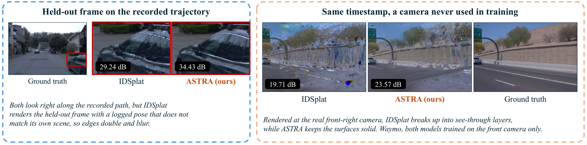
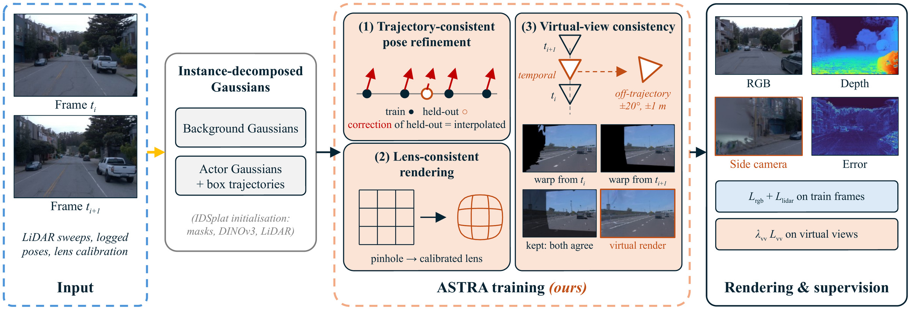
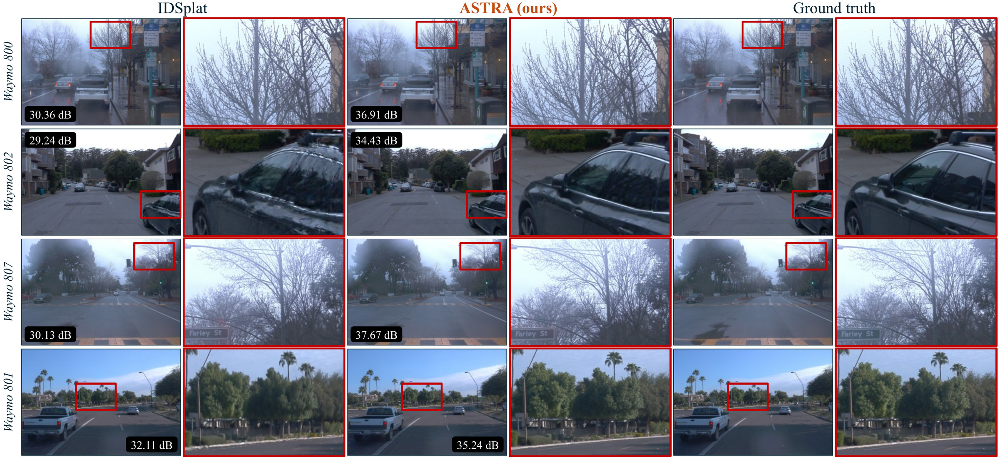
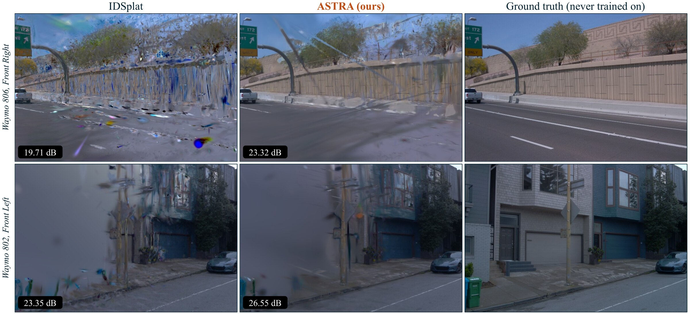

<h1 align="center">ASTRA</h1>

<p align="center">
  <b>Driving-Scene Gaussian Splatting that Holds Up off the Recorded Trajectory</b>
</p>

<p align="center">
  <a href="https://github.com/zenseact/idsplat">
    
  </a>
  
  <a href="https://drive.google.com/drive/folders/1ZmVEwQ7Zw_ymfHw06QawHFZSbmk0pUk0">
    
  </a>
  <a href="https://github.com/ChizkiyahuOhayon/ASTRA/releases/tag/checkpoints-v1">
    
  </a>
  
</p>

<p align="center">
  <br>
  <em>Left: a held-out frame on the recorded drive. Right: the same moment seen by a real camera that no model used
  in training. IDSplat fits the recorded path but breaks up next to it; ASTRA keeps the scene solid.</em>
</p>

## 📜 News

🔥 **[2026/10]** Code, the held-out-camera benchmark, pseudo-label masks for KITTI / nuScenes / PandaSet, trained
checkpoints for KITTI / nuScenes / PandaSet and the result file of every run in the paper are released.

## ✒️ Contents

- [Overview](#-overview)
- [Results](#-results)
- [Installation](#%EF%B8%8F-installation)
- [Data](#-data)
- [Training](#-training)
- [Evaluation](#-evaluation)
- [Reproducing the paper tables](#-reproducing-the-paper-tables)
- [Checkpoints](#-checkpoints)
- [Repository layout](#%EF%B8%8F-repository-layout)
- [License](#-license)
- [Citation](#-citation)
- [Acknowledgment](#-acknowledgment)

## 👀 Overview

A driving simulator built from a recorded drive must show the scene from places the car never was, such as the
next lane or a camera turned to the side. Today's benchmarks do not test this. They hold out every fourth frame of
the drive and score the render there, and a held-out frame lies between two training frames about one meter apart.

We test views off the path with data that already exists. Waymo records five cameras and the benchmark trains on
the front camera only, so we render each trained model at the **real front-left and front-right cameras** of the
same moments. IDSplat drops from **34.7 dB** on the standard held-out frames to **19.8 dB** at these cameras, even
on pixels the front camera saw and after matching the exposure of each camera.

We trace the drop to three causes and remove each one, using only the training images:

| Cause | ASTRA component | Flags |
|---|---|---|
| The logged camera poses are slightly wrong. The scene absorbs the error at training frames; held-out frames keep it. | **(1) Trajectory-consistent pose refinement.** Learn a pose correction for every training image and compute the correction of any other moment by interpolating the two nearest training frames. | `POSE` in [`flags.sh`](scripts/astra/flags.sh) |
| The common Waymo pipeline renders an ideal pinhole image and compares it with the real, distorted image (up to 30 px off in the corners). | **(2) Lens-consistent rendering.** Render a slightly larger pinhole feature image and resample it through the calibrated lens model before the decoder. | `LENS` |
| Every training image comes from the recorded path. | **(3) Virtual-view consistency.** Render virtual cameras between two recorded frames and, half of the time, turned (±20°) and shifted sideways (±1 m). Supervise them with the two real neighbours warped into the view, keeping a pixel only where both warps agree. | `VVC` |

<p align="center">
  <br>
  <em>ASTRA keeps the IDSplat scene representation (grey) and changes how it is posed, rendered and supervised (orange).</em>
</p>

No 3D annotations, no generative model and no extra network are used, and the same settings run on all four
datasets. At test time ASTRA renders the same Gaussians with the same rasteriser as IDSplat.

## 📊 Results

Every ASTRA and "reproduced" number below comes from the scripts in this repository, one run per scene. Rows
without "reproduced" are copied from the AD-GS and IDSplat papers. † uses annotated 3D boxes. **Bold**: best.

### Waymo: 8 sequences, front camera, every 4th frame held out

| Method | PSNR ↑ | SSIM ↑ | LPIPS ↓ | DPSNR ↑ |
|---|---|---|---|---|
| StreetGS† | 33.97 | 0.926 | 0.227 | 28.50 |
| 4DGF† | 34.64 | 0.940 | 0.244 | 29.77 |
| SplatAD† | 34.24 | 0.925 | 0.246 | 29.68 |
| PVG | 29.54 | 0.895 | 0.266 | 21.56 |
| EmerNeRF | 31.32 | 0.881 | 0.301 | 21.80 |
| Grid4D | 32.19 | 0.921 | 0.253 | 22.77 |
| AD-GS | 33.91 | 0.927 | 0.228 | 27.41 |
| IDSplat | 34.59 | 0.929 | 0.235 | 29.63 |
| IDSplat (reproduced) | 34.68 | 0.931 | 0.232 | 30.24 |
| **ASTRA** | **36.18** | **0.945** | **0.218** | **30.89** |

DPSNR is PSNR inside the boxes of actors faster than 1 m/s. Ours uses the ground-truth boxes (IDSplat code, for
evaluation only); the published rows use the StreetGS dynamic masks.

### Held-out cameras (new benchmark): Waymo front-left / front-right, never trained on

"Visible" counts only pixels that the front camera also saw; the mask is computed once from the IDSplat depth and
shared by all methods. "+ colour" matches the exposure of each image with a per-channel gain and offset.

| Method | PSNR (all) ↑ | PSNR (visible) ↑ | + colour ↑ | SSIM ↑ | LPIPS ↓ |
|---|---|---|---|---|---|
| IDSplat (reproduced) | 13.98 | 17.48 | 19.76 | 0.662 | 0.217 |
| **ASTRA** | **14.75** | **18.59** | **20.63** | **0.699** | **0.203** |

ASTRA is better than IDSplat on all 8 sequences.

### KITTI, nuScenes and PandaSet (same settings as Waymo)

| Dataset | Protocol | Metric | AD-GS | IDSplat (reproduced) | **ASTRA** |
|---|---|---|---|---|---|
| KITTI | 75% train | PSNR / SSIM / LPIPS-Alex | 29.16 / **0.920** / **0.033** | 27.35 / 0.874 / 0.057 | **29.27** / 0.911 / 0.040 |
| KITTI | 50% train | PSNR / SSIM / LPIPS-Alex | **28.51** / **0.912** / **0.035** | 25.70 / 0.829 / 0.068 | 28.22 / 0.883 / 0.044 |
| KITTI | 25% train | PSNR / SSIM / LPIPS-Alex | 24.12 / **0.868** / 0.065 | 23.46 / 0.777 / 0.090 | **25.45** / 0.845 / **0.059** |
| nuScenes | 6 scenes, 3 cams | PSNR / SSIM / LPIPS-VGG | 31.06 / 0.925 / **0.164** | 31.41 / 0.919 / 0.207 | **32.40** / **0.935** / 0.193 |
| PandaSet | 10 seqs, 6 cams | PSNR / SSIM / LPIPS-Alex | – | 26.79 / 0.812 / 0.172 | **27.39** / **0.829** / **0.160** |

On PandaSet the published IDSplat result is 26.78 / 0.814 / 0.174 and SplatAD† reaches 26.76 / 0.815 / 0.193.
Full tables, ablations and per-scene numbers: [`docs/RESULTS.md`](docs/RESULTS.md).

### Ablation (Waymo, 8 sequences)

Each row adds one component to the row above. "Side cams" is PSNR at the held-out front-left / front-right cameras
(visible pixels, after colour matching). Best value of each column in bold.

| Configuration | PSNR ↑ | SSIM ↑ | LPIPS ↓ | DPSNR ↑ | Side cams ↑ |
|---|---|---|---|---|---|
| IDSplat (reproduced) | 34.68 | 0.931 | 0.232 | 30.24 | 19.76 |
| + trajectory-consistent pose refinement | 36.07 | 0.944 | 0.220 | 30.62 | 19.45 |
| + temporal virtual views | 36.20 | 0.944 | 0.219 | 30.68 | 19.79 |
| + lens-consistent rendering | **36.27** | **0.945** | **0.218** | 30.82 | 20.20 |
| + off-trajectory virtual views (**ASTRA**) | 36.18 | **0.945** | **0.218** | **30.89** | **20.63** |

Pose refinement gives most of the gain on held-out frames. Lens-consistent rendering and off-trajectory virtual views
add most of their gain at the side cameras and on moving objects (DPSNR). Correcting only the training poses, without
interpolating the corrections to the test frames, drops PSNR to 31.40 dB. The leave-one-out table is in
[`docs/RESULTS.md`](docs/RESULTS.md).

<p align="center">
  <br>
  <em>Held-out Waymo frames (full frame + enlarged crop) for IDSplat, ASTRA and the real image.</em>
</p>

<p align="center">
  <br>
  <em>Held-out side cameras on Waymo. Darkened pixels were never seen by the front camera.</em>
</p>

## 🛠️ Installation

Tested on Ubuntu 22.04 with an RTX 4090 (48 GB) and CUDA 11.8 / 12.4. The environment is exactly IDSplat's.

```bash
git clone https://github.com/ChizkiyahuOhayon/ASTRA.git
cd ASTRA
# install uv once: curl -LsSf https://astral.sh/uv/install.sh | sh
uv sync                 # creates .venv with torch, the SplatAD gsplat fork, SAM 2, ...
uv run python -c "import gsplat, torch; print(torch.cuda.is_available())"
```

- **GPU / CUDA.** `pyproject.toml` ships IDSplat's CUDA 12.8 index (RTX 50xx). For older GPUs swap the two
  commented `[tool.uv]` blocks to the CUDA 12.4 index before `uv sync`. On drivers that only support CUDA 11.8 we
  used `https://download.pytorch.org/whl/cu118` with `TORCH_CUDA_ARCH_LIST=8.9`.
- **DINOv3** (`facebook/dinov3-vitb16-pretrain-lvd1689m`) is gated on Hugging Face: accept the licence, then
  `huggingface-cli login` with your own token. After the first download, `export HF_HUB_OFFLINE=1`.
- **SAM 2.1 checkpoint** for the mask tools: download `sam2.1_hiera_large.pt` from the
  [SAM 2 release](https://github.com/facebookresearch/sam2#model-description) into `checkpoints/`.

## 📦 Data

[`docs/DATA.md`](docs/DATA.md) walks through every step. Everything lives under one root:

```
data/
├── wod/validation/{camera_image,camera_calibration,lidar,lidar_calibration,vehicle_pose,...}   # Waymo v2 parquet
├── wod_gt_masks/<sequence>/gt_masks/*.npz        # eval-only DPSNR masks (tools/make_gt_masks.py)
├── kitti/training/{image_02,image_03,velodyne,calib,oxts}
├── nuscenes/{samples,sweeps,v1.0-trainval,maps}
├── pandaset/<seq>/{camera,lidar,meta}
└── masks/{waymo,kitti,nuscenes,pandaset}/        # Grounded-SAM-2 tracked instance masks
```

| What | Where |
|---|---|
| Waymo Open Dataset v2 (8 validation segments) | official download, [waymo.com/open](https://waymo.com/open) (licence forbids redistribution) |
| Waymo instance masks | generate with `tools/make_masks_wod.py` (about 10 min per segment) |
| KITTI-MOT sequences 0001 / 0002 / 0006 | [cvlibs.net](https://www.cvlibs.net/datasets/kitti/eval_tracking.php) |
| nuScenes (6 AD-GS scenes) | [nuscenes.org](https://www.nuscenes.org/nuscenes) |
| PandaSet (10 IDSplat sequences) | [Hugging Face](https://huggingface.co/datasets/georghess/pandaset) |
| **Our masks for KITTI / nuScenes / PandaSet** and **all result files** | [Google Drive](https://drive.google.com/drive/folders/1ZmVEwQ7Zw_ymfHw06QawHFZSbmk0pUk0) |

## 🚀 Training

Every script takes the method as `--method`: `astra` (the paper's method), `idsplat`, or an ablation from
[`scripts/astra/flags.sh`](scripts/astra/flags.sh) (`astra-pose`, `astra-temporal`, `astra-nooff`,
`astra-nopose`, `astra-nolens`, `astra-novvc`).

```bash
# Waymo, scene ids 800..807 (scripts/arrays/wod_id_to_seq_adgs_split.txt)
bash scripts/astra/train_waymo.sh --scene 802 --data data/wod --masks_dir data/masks/waymo \
     --gt_masks_dir data/wod_gt_masks --tfrecord_dir data/wod/v1 --method astra

# KITTI, --split 75 | 50 | 25
bash scripts/astra/train_kitti.sh --sequence 0001 --split 75 --data data/kitti --masks_dir data/masks/kitti

# nuScenes
bash scripts/astra/train_nuscenes.sh --scene scene-0230 --data data/nuscenes --masks_dir data/masks/nuscenes

# PandaSet (needs the GPU alone)
bash scripts/astra/train_pandaset.sh --sequence 001 --data data/pandaset --masks_dir data/masks/pandaset
```

Each run is 30k steps on one GPU. Two Waymo, KITTI or nuScenes runs fit on one 48 GB card at the same time.

## 📏 Evaluation

```bash
# Waymo held-out frames: PSNR / SSIM / LPIPS / DPSNR
bash scripts/astra/eval_waymo.sh --config outputs/astra-802/idsplat-wod/<time>/config.yml \
     --data data/wod --gt_masks_dir data/wod_gt_masks --out results/astra-802.json

# KITTI / nuScenes / PandaSet held-out frames
bash scripts/astra/eval_render.sh --config outputs/astra-kitti0001-75/idsplat/<time>/config.yml \
     --out results/astra-kitti0001-75

# Held-out cameras: evaluate the IDSplat model of a scene first, its depth defines the shared visibility masks
bash scripts/astra/eval_xcam.sh --config outputs/idsplat-802/idsplat-wod/<time>/config.yml \
     --mask_dir results/xcam/masks --out results/xcam/idsplat-802.json
bash scripts/astra/eval_xcam.sh --config outputs/astra-802/idsplat-wod/<time>/config.yml \
     --mask_dir results/xcam/masks --out results/xcam/astra-802.json
python tools/xcam_table.py results/xcam idsplat astra
```

## 🔁 Reproducing the paper tables

[`docs/REPRODUCE.md`](docs/REPRODUCE.md) lists every run behind every table as copy-paste loops. The result file of
each of our runs is in the Drive folder (`results.tar.gz`), and `tools/make_tables.py <results_dir> <out_dir>`
turns a results folder into the paper tables, so you can check any number without retraining.

## 💾 Checkpoints

Trained ASTRA checkpoints for all KITTI, nuScenes and PandaSet runs of the paper are attached to the
[GitHub release](https://github.com/ChizkiyahuOhayon/ASTRA/releases/tag/checkpoints-v1) (pipeline state only, one archive per dataset, with SHA-256 sums). Unpack into
`outputs/` and evaluate with `scripts/astra/eval_render.sh`; [`docs/REPRODUCE.md`](docs/REPRODUCE.md#evaluating-the-released-checkpoints)
shows how to point the configs at your data folder.

Waymo checkpoints are not distributed: a Gaussian-splatting checkpoint is a reconstruction of the Waymo data,
which the Waymo licence does not allow us to share. Each Waymo scene can be retrained with the command above.

## 🗂️ Repository layout

```
nerfstudio/                       IDSplat code base (Nerfstudio) with the ASTRA components
  models/idsplat.py               pose interpolation (_interp_camopt), lens rendering (_lens_grid/_lens_warp)
  model_components/astra_tivc.py  virtual-view consistency
  pipelines/idsplat_pipeline.py   loss wiring (--pipeline.tivc_*)
  data/dataparsers/               + KITTI-MOT and nuScenes parsers, AD-GS EVERY_N split
scripts/astra/                    training / evaluation entry points and the component flags
tools/                            mask generation, DPSNR GT masks, render dumps, metrics, held-out-camera benchmark
docs/                             data guide, reproduction guide, full results
```

## 📄 License

Apache 2.0, as the IDSplat code it builds on (see `LICENSE` and `NOTICE`). Datasets keep their own licences; the
released masks and checkpoints for KITTI (CC BY-NC-SA 3.0), nuScenes (CC BY-NC-SA 4.0) and PandaSet (CC BY 4.0)
are derived from those datasets and inherit their terms.

## 📌 Citation

The ASTRA paper is under review. Until it is public, please cite IDSplat, on which this code is built:

```bibtex
@inproceedings{lindstrom2026idsplat,
  title     = {{IDSplat}: Instance-Decomposed {3D} {Gaussian} Splatting for Driving Scenes},
  author    = {Lindstr{\"o}m, Carl and Rafidashti, Mahan and Fatemi, Maryam and Hammarstrand, Lars and Oswald, Martin R. and Svensson, Lennart},
  booktitle = {CVPR},
  year      = {2026}
}
```

## 🙏 Acknowledgment

ASTRA is built on [IDSplat](https://github.com/zenseact/idsplat) (Zenseact), which builds on
[SplatAD](https://github.com/carlinds/splatad), [NeuRAD-studio](https://github.com/georghess/neurad-studio) and
[Nerfstudio](https://github.com/nerfstudio-project/nerfstudio). The KITTI and nuScenes parsers are ported from
NeuRAD-studio. Masks are produced with [Grounding DINO](https://github.com/IDEA-Research/GroundingDINO) and
[SAM 2](https://github.com/facebookresearch/sam2). We thank the authors of AD-GS for their evaluation protocol.
